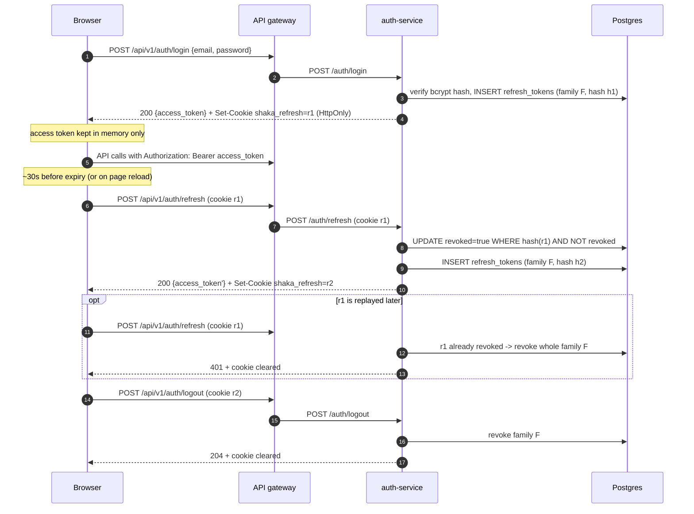

# Auth Service

Provides account registration, JWT access-token issuance, and refresh-token
rotation.

## Configuration

The service requires `DATABASE_URL` and `JWT_SECRET`. The signing secret must
be at least 32 bytes. `JWT_ISSUER` defaults to `shaka-mesh-auth`, `JWT_TTL`
defaults to `15m`, and `HTTP_ADDR` defaults to `:8081`.

| Variable | Default | Meaning |
| --- | --- | --- |
| `REFRESH_TOKEN_TTL` | `168h` | Lifetime of a refresh token (7 days). Each rotation issues a fresh full-length token. |
| `REFRESH_COOKIE_SECURE` | `true` | `Secure` flag on the refresh cookie. Local `docker-compose.yml` sets `false`; the cloud overlay keeps `true`. |
| `REFRESH_COOKIE_SAMESITE` | `lax` | `lax`, `strict` or `none` (`none` requires Secure). |
| `REFRESH_COOKIE_PATH` | `/api/v1/auth` | Path the browser sends the cookie to. It is the *gateway* path the browser sees, not this service's `/auth`. |

> Browsers drop `Secure` cookies on plain `http://` origins (Safari always;
> Chrome and Firefox only make an exception for `localhost`). If sign-in works
> but a page reload signs you out on local HTTP, set
> `REFRESH_COOKIE_SECURE=false` (the local compose file already does).

## Endpoints

| Method and path | Purpose |
| --- | --- |
| `POST /auth/register` | Create an account. Duplicate emails return `409`. |
| `POST /auth/login` | Verify credentials. Returns the access token in JSON and sets the refresh cookie. |
| `POST /auth/refresh` | Reads the refresh cookie, rotates it, returns a new access token. `401` (and a cleared cookie) if the token is unknown, expired, revoked or replayed. |
| `POST /auth/logout` | Revokes the whole token family and clears the cookie. Idempotent, always `204`. |
| `GET /health` | Liveness. |

Login and refresh responses look like
`{"access_token": "...", "token_type": "Bearer", "expires_at": "...", "email": "..."}`.
The refresh token is **never** in the body; it only travels in the
`HttpOnly; Secure; SameSite=Lax` cookie `shaka_refresh`, so page scripts
cannot read it. The browser keeps the access token in memory only.

New passwords (`/auth/register`) must be 10-72 bytes, must not be on the embedded
common-password list (`internal/service/common_passwords.txt`, case-insensitive),
must not be one repeated character, and must not equal the email address (or its
local part). A rejected password returns `400` listing every broken rule:
`{"error": "password does not meet requirements: ...", "problems": ["must be at least 10 characters long", ...]}`.
Login does not apply the policy, so accounts created under the old 8-byte
minimum can still sign in; they are only checked for being non-empty and at most
72 bytes. Password hashes use bcrypt and are never included in API responses.
Login failures return the same generic `401` response. The gateway rate-limits
login and register (see the api-gateway README).

## Refresh tokens

- A refresh token is 256 random bits, base64url-encoded. Only its SHA-256 hash
  is stored (table `refresh_tokens`: user id, family id, expiry, revoked flag).
- Every login starts a new *family*. Each refresh revokes the presented token
  and issues a new one in the same family.
- Presenting a token that was already revoked is treated as theft: the whole
  family is revoked, so the attacker and the real user must both sign in again.
  Two simultaneous refreshes with the same token also count as reuse, so the
  web client serializes refreshes (see `web/lib/use-auth-session.ts`).



## Database

When run directly, the database schema in `deployments/init_db.sql` must
already have been applied. Existing database volumes do not rerun initialization
scripts; apply the migrations in `deployments/migrations/` in order
(`001_create_users.sql`, then `002_create_refresh_tokens.sql`) to those
databases before starting the service. Both are idempotent
(`CREATE ... IF NOT EXISTS`):

```sh
docker compose -f deployments/docker-compose.yml exec -T beach-db \
  psql -U shaka_user -d shaka_beach_db < deployments/migrations/002_create_refresh_tokens.sql
```

Expired and revoked rows are not purged automatically yet (see the follow-ups
in the PR); a periodic `DELETE FROM refresh_tokens WHERE expires_at < now()`
is safe.

## Tests

Run `go test ./...` and `go vet ./...` from this directory.

### Integration tests

Repository integration tests run against a real PostGIS database started with
`testcontainers-go` (image `postgis/postgis:16-3.4`). They cover user creation,
the duplicate-email conflict (`ErrEmailInUse`, including a concurrent
registration race) and lookup by email. They sit behind the `integration` build
tag, so plain `go test ./...` stays fast and needs no Docker. To run them, start
Docker and run:

```bash
go test -tags=integration ./...
```

The container is initialised with `deployments/init_db.sql`, the same file
Docker Compose mounts into Postgres.
